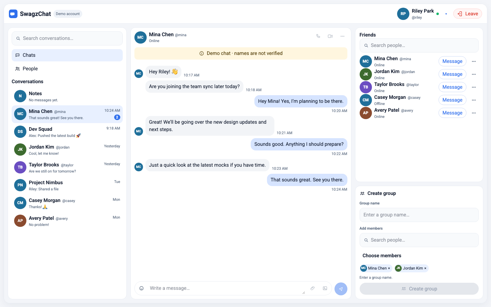

# SwagzChat

Angular 22 chat client in `web/`, with a Node service and MongoDB in `server/`.

## Run locally

Start MongoDB and the API:

```bash
docker compose up --build
```

In another terminal, from `web/`, use Node 22:

```bash
npm start
```

Open http://127.0.0.1:4200, enter a name, and the chat workspace opens. The API is http://127.0.0.1:3000.

## Preview

With the development server running, open http://127.0.0.1:4200/preview. That route shows Riley’s fixed fixture: Notes first, Mina selected, and the group form waiting on a name. It stays on the development server. A production build returns to the name form.



The phone capture is [preview-390x844.png](docs/ui-revamp/captures/preview-390x844.png). The visual target is [reference.png](docs/ui-revamp/reference.png).

## Milestone design

The signed-off visual pass is recorded in [docs/ui-revamp/visual-fidelity-handoff.md](docs/ui-revamp/visual-fidelity-handoff.md). Product behavior and fixture copy stay in [docs/ui-revamp/spec.md](docs/ui-revamp/spec.md).

| Milestone | Design |
| --- | --- |
| 1. Group picker | Keep the name field, member search, and selected chips visible. Hide the unfiltered friend list until the user searches or opens **Choose members**. An empty name keeps **Create group** disabled with “Enter a group name.” |
| 2. Thread and frame | Put the header and three panes in one rounded frame. Show initials on the first bubble of a consecutive incoming run. Place each timestamp on the bubble’s trailing edge. Keep Notes first, initials instead of portraits, and no receipt marks. |
| 3. Compact layouts | Check 1024 × 768, 768 × 1024, and 390 × 844. Friends scrolls inside its card. Keyboard focus covers navigation, rows, member choices, chips, and the composer. |
| 4. Sign-off | Run the checks below, capture `/preview` at 1600 × 1000 and 390 × 844, and confirm the preview does not call the live chat service. |

Still deferred: calls, video, and attachments stay disabled, and preview Leave still clears the stored guest.

## Checks

From `web/`:

```bash
npm test -- --watch=false
npm run build
```

From `server/`:

```bash
node --test src/handle.test.js
```
