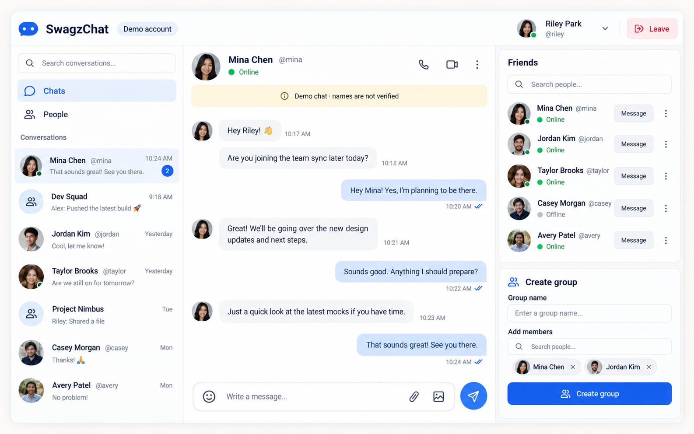

# SwagzChat UI and Features Revamp

**Status: READY TO HAND-OFF**  
**Project:** `SwagzChat`  
**Implementation target:** `SwagzChat/web/` (Angular 22 client)  
**Visual source of truth:** [`reference.png`](./reference.png)

> Implement the SwagzChat chat workspace to match the attached reference image as closely as practical. The reference defines the desktop composition, visual hierarchy, labels, and visible controls. Keep the existing Angular 22 client and Node/Mongo chat service.

## 1. Objective

Replace the current plain three-pane chat shell with the polished, trustworthy workspace shown in `reference.png`. The result should make these tasks immediately discoverable:

1. Find and open a conversation.
2. Read and send messages.
3. Find people and start a friend conversation.
4. Review friends and presence.
5. Select friends and create a named group.
6. Understand that the current identity is a demo guest and display names are not verified.

The rendered screen should resemble the reference in a 1600 × 1000 desktop viewport. The image file is 1586 × 992; match the composition, not those 14 pixels. Preserve the image's three-column structure, header, key copy, colors, spacing rhythm, and visible controls. Do not add unrelated product areas.

## 2. Product and implementation context

- The client is `SwagzChat/web/`, built with Angular 22, standalone components, signals, and Angular Material.
- The client uses a guest name and the local API at `http://127.0.0.1:3000`.
- The Node service and MongoDB are in `SwagzChat/server/` and `SwagzChat/docker-compose.yml`.
- Keep the revamp aligned with the `web/` data path. Do not introduce Firebase.
- Current supported concepts include own, friend, and group conversations; people directory; mutual friendships; message history; unread counts; and online presence.
- Existing glossary terms in `SwagzChat/GLOSSARY.md` are authoritative. Use “conversation,” “friend,” “group conversation,” “member,” “guest,” and “handle” consistently. Avoid “DM,” “private chat,” “account,” and “channel” for these concepts. The on-screen chip still reads **Demo account**, matching the reference.

## Settled choices

These choices override a still image where the image and the product rules disagree. Sign-off uses this list.

1. **Notes stays pinned.** The own conversation titled **Notes** is the first conversation row. `reference.png` was drawn without it. A matching screenshot includes Notes above Mina Chen. That extra row is correct.
2. **A handle is stored once.** Each profile has a unique `handle`. `PUT /account` with `{ id, name }` creates it if missing and returns `{ id, handle }`. Profile lists include `handle`. It does not change when the display name changes.
3. **Handle rule.** Lowercase the display name and keep letters and digits. If fewer than 3 characters remain, use `guest`. Trim to 16 characters. If that value is taken, append `_` plus the first 4 letters or digits of the guest id, shortening the base so the full handle is at most 20 characters. If it is still taken, append `2`, then `3`, and so on. Allowed characters are `a-z`, `0-9`, and `_`. The demo fixture in section 10 writes its handles directly instead of using this rule.
4. **People replaces the conversation list only.** With **Chats** selected, the left column is the reference conversation list. With **People** selected, that same column becomes the directory of people who are not the current guest and not already friends. Each directory row has an avatar, display name, `@handle`, presence text, and **Add**. The open conversation, its draft, and the right Friends / Create group column stay put.
5. **Emoji inserts a character.** The composer emoji control opens a picker and inserts the chosen character into the draft. It does not send. The picker includes at least 👋, 🚀, and 🙏. The control is present and works.
6. **Earlier messages use one new read.** `GET /conversations/:id/messages?before=<createdAt>&limit=50` returns up to 50 older messages in ascending `createdAt` order for a member. `before` is the oldest `createdAt` already on screen. An empty list means there is nothing older, and the client hides **Load earlier messages**. The client shows that action when the newest page contains 50 messages.
7. **The filled Create group button is the enabled style.** Use it only when the name is non-empty and at least two friends are selected. Otherwise the button is disabled and the reason is written next to it. The reference shows the enabled appearance.
8. **Photographs and read marks are not sign-off requirements.** Avatars are stable initials and colors. Outgoing read marks stay omitted until the service stores that state. The reference’s photos and check marks are illustrations of layout, not data the app must reproduce.

The service may gain the `handle` field and the earlier-message read above. No other schema or route change is part of this revamp.

## 3. Reference screen inventory

### Global header

- Left: blue chat mark and **SwagzChat** wordmark.
- Beside the wordmark: a low-emphasis **Demo account** chip.
- Right: avatar, **Riley Park**, **@riley**, online presence dot, profile menu caret, divider, and red outlined **Leave** action.
- Keep the header one line at the reference desktop width. On smaller screens, collapse account details before removing the app identity or Leave action.

### Left navigation and conversation list

- Search field: **Search conversations…**
- Primary nav: **Chats** selected and **People** unselected, each with an icon and text.
- Section label: **Conversations**.
- Conversation rows show avatar, display name, stable `@handle` on friend rows, last activity time, latest-message preview, and unread badge where applicable. **Notes** has no `@handle`.
- Selected conversation row uses a pale blue background and a blue unread count badge.
- Include the reference content shape, with **Notes** pinned above it: one unread friend conversation, group conversations, and additional friend conversations. Do not hard-code example messages as production data.

### Main conversation

- Header: avatar, display name, `@handle`, presence dot plus **Online** text; phone, video, and more-actions controls aligned to the right.
- Beneath the header, show the light amber disclosure banner with info icon and exact copy: **Demo chat · names are not verified**.
- Message history uses distinct incoming and outgoing bubbles, readable timestamps, and delivery/read marks for the current user's outgoing messages when the service can substantiate that state.
- Keep message width readable and preserve whitespace between turns. Long messages wrap without widening beyond the conversation column.
- Composer: visible rounded input with a working emoji control, **Write a message…**, attachment, and image controls; separate circular blue send action.
- The send action is disabled when the draft is empty or a send is in progress. Enter sends; Shift+Enter inserts a newline if multiline composition is supported. Preserve the draft when a send fails.

### Right friends and group panel

- **Friends** card includes **Search people…** and rows with avatar, display name, `@handle`, text presence, **Message** action, and more-actions menu.
- Presence must be conveyed with both a dot and the text **Online** or **Offline**.
- **Create group** card includes group-name input, member search, selected-member chips with remove actions, and a prominent **Create group** button.
- The reference shows two selected people and the enabled **Create group** style. Group creation requires a name and at least two other members. The button uses that filled style only when both are present.

## 4. Design principles

Use these principles to resolve implementation choices while preserving the reference. They are product constraints, not optional visual polish.

1. **Conversation first.** The active message thread is the primary work surface. Keep the selected person, message history, and composer visually dominant; secondary people management should remain available without competing with the conversation.
2. **Identity is explicit and honest.** Show a display name and a stable, unique handle together. Keep the demo-account and unverified-name cues visible. Never imply that a name, presence state, message delivery mark, or conversation is verified or private unless the system can prove it.
3. **State is visible.** Selection, unread messages, presence, loading, failure, disabled actions, and successful changes need clear text, shape, icon, or status feedback. Do not make color the only signal.
4. **Actions are reversible or explained.** Search is non-destructive. Friend removal offers undo or a confirmation. Failed sends preserve text. Group creation failures preserve the form. Leave has a clear destination and effect.
5. **Progressive disclosure keeps the workspace calm.** Show the core controls in the reference by default. Put secondary actions in labeled menus. Disable unsupported phone, video, emoji, and attachment actions with an explanation instead of exposing empty or fake flows.
6. **One coherent visual system.** Reuse the same spacing, type scale, borders, avatar treatment, icon size, and interaction states across the header, conversation rows, message thread, friend list, and group form. Keep blue for primary/selected states, amber for the demo disclosure, and red for Leave/destructive actions.
7. **Responsive behavior preserves task continuity.** On compact screens, move between list, People, and thread panes without losing the user's selection or draft. Do not merely compress the desktop columns.
8. **Accessible behavior is part of the design.** Labels, keyboard operation, visible focus, readable contrast, announcements, and reduced-motion behavior must be designed into the components rather than added after visual implementation.

## 5. Visual specification

Use the reference image as the pixel-level comparison target. The values below are implementation starting points; adjust against the image rather than introducing a different design system.

### Overall layout

- At wide desktop sizes, use a full-height application shell with a top header and three columns below it.
- Reference proportions: left navigation/list about 25%, message thread about 45%, right panel about 27%, with narrow separators/gutters.
- Give the three regions separate white or near-white surfaces, subtle neutral borders, and rounded outer corners.
- Keep scroll ownership inside the conversation list, message history, and right panel. The composer and global header stay visible while scrolling.
- Maintain the screenshot’s dense but comfortable content. Avoid oversized padding that pushes key rows off screen.

### Color and type

- Canvas/surfaces: white and very light cool gray with restrained lavender-gray variation.
- Primary accent: clear medium/deep blue for selected navigation, online-independent actions, outgoing bubbles, unread badge, and send button.
- Text: deep navy for primary labels, medium slate for metadata, and muted slate for timestamps.
- Disclosure banner: soft pale amber with dark readable text and an info icon.
- Destructive/exit action: red text/icon on a pale red outlined control.
- Use existing Material theme tokens where they can match the reference; add a small, documented set of CSS variables only for missing values.
- Use a consistent sans-serif type scale: prominent app name and conversation title, compact but readable row labels and metadata.

### Components and interaction styling

- Use consistent border radius, thin separators, low-contrast card borders, and restrained shadows. Avoid heavy elevation.
- Selected navigation and conversation rows use both shape/surface and accessible state (`aria-current`, `aria-selected`, or `aria-pressed` as appropriate).
- All icon-only controls need accessible names and visible keyboard focus.
- Avatars must have a deterministic fallback with initials. Do not use random avatars or change a person's avatar between renders.

## 6. Feature requirements

### A. Identity and demo disclosure

- Keep the current guest flow unless identity/authentication is separately changed by an approved project decision.
- Header shows the guest display name and the stored `@handle`. Two guests with the same display name still have different handles.
- The **Demo account** chip and **Demo chat · names are not verified** banner remain visible in the chat workspace. Do not imply verified identity, encryption, or private communication.
- Profile menu exposes the current guest name/handle and a Leave action. Leave returns to the entry screen and clears only the current browser's guest session, consistent with existing behavior.
- Do not add a profile photo upload. Avatars are the initials and stable colors from section 10.

### B. Conversation navigation and search

- **Chats** is the initial selected navigation item after entering the workspace.
- Under **Chats**, search filters conversation rows by visible label and latest-message preview. It must not mutate or delete conversations.
- Conversation ordering follows most recently updated first, after pinned **Notes**.
- Activity time uses the viewer’s local calendar: time only on the same day, **Yesterday** on the previous day, a short weekday from two to six days ago, and a short date after that. Fixture mode uses the fixed clock in section 10 so those labels stay stable.
- Row previews, timestamps, and unread counts update when new message/inbox data arrives.
- Selecting a row opens its message history, highlights the row, and marks it read using the existing service behavior.
- Empty, loading, and error states need clear text and a retry affordance where retry is possible. Do not leave a permanent spinner after a request fails.

### C. People, friends, and presence

- **People** replaces the left conversation list with the directory, as settled above. The open conversation and the right-hand Friends column stay visible.
- The left search filters whichever list is showing: conversations under **Chats**, the directory under **People**. The Friends card search filters friends only. Both match display name and `@handle`, and conversation search also matches the latest-message preview. Search does not change stored data.
- **Add** creates a mutual friendship, updates both relevant views, and provides success/error feedback.
- **Message** opens an existing friend conversation or creates one if needed, then selects it.
- Friend more-actions includes **Unfriend**. Ask for confirmation or provide a short-lived Undo affordance before the change becomes final; explain that friendship and existing conversation membership are separate.
- Show Online/Offline text as well as the dot. Loading and unavailable presence have a distinct neutral label instead of being shown as Offline.
- Duplicate display names are distinguished by stable `@handle` in every people/friend row and relevant conversation context.

### D. Messaging

- Render incoming and outgoing messages with readable, wrapping text and local-time timestamps.
- Send through the existing API and clear the draft only after success. On failure, keep the draft and show an inline error with retry behavior.
- Prevent empty sends and double submission.
- Keep the latest message in view when new messages arrive unless the user has intentionally scrolled away; when scrolled away, show a new-message affordance instead of forcing scroll.
- Show message delivery/read marks only when backed by reliable server state. Until that exists, omit the marks rather than presenting a false status.
- Display the unread count in conversation rows, clear it when a conversation is opened, and announce changes accessibly.
- When the newest page has 50 messages, show **Load earlier messages** at the top of the history. It calls `GET /conversations/:id/messages?before=<createdAt>&limit=50` and prepends the result. Hide the action when that response is empty. Do not drop older history without this action.

### E. Group conversations

- Group creation includes a name, friend search, selected-member chips, and a clear minimum of two other members.
- Disable **Create group** until the group name and minimum membership are valid. Write the reason inline. The disabled control is not a second visual design; the reference’s filled button is the enabled state.
- On success, create the group conversation using the existing API, clear the group form, and open the new conversation.
- On failure, preserve the name and selected members and show a useful message.
- Keep group selection and the member picker keyboard-operable; selected state must not rely on color alone.
- Current server behavior creates groups from friends only. Do not expose non-friends as selectable group members.

### F. Visible but not-yet-supported actions

The screenshot includes phone, video, emoji, attachment, image, and overflow controls. Preserve their appearance, but do not create fake functionality.

- **Phone** and **video**: if call infrastructure is not implemented in this handoff, render as visibly disabled controls with accessible explanation such as “Calls are not available in this demo.” Keep them in the header to preserve visual matching. Enable only when a real, authorized call flow exists.
- **Emoji**: the reference control opens the picker from the settled choices and inserts into the draft. Keep the icon. Do not omit it and do not leave it disabled.
- **Attachment** and **image**: preserve the visual controls as disabled with an explanation until upload, storage, and access rules are implemented. Do not show a fake file picker that cannot send.
- **More actions**: provide a working menu with only implemented options, or disable it with an accessible explanation. Do not expose destructive actions without confirmation/undo.

## 7. Responsive behavior

Desktop is the fidelity target shown in the image. Preserve the same functions at narrower widths, using a deliberate navigation transition rather than shrinking three columns until they are unusable.

- **Wide desktop (≥ 1200 px):** show all three columns; keep the message thread as the visual center.
- **Compact desktop/tablet (801–1199 px):** reduce the side columns with a minimum readable width; allow the right panel to collapse behind a People action if necessary.
- **Mobile (≤ 800 px):** show one primary pane at a time. Start on Chats; People opens the directory; opening a conversation enters the thread and exposes Back. Keep Leave reachable from the header/account menu.
- At all widths, do not cause horizontal page scrolling. The thread composer remains reachable above the on-screen keyboard and stays in the selected conversation pane.
- Validate the composition in a 1600 × 1000 viewport against the 1586 × 992 reference, and validate behavior at 1024 × 768, 768 × 1024, and 390 × 844.

## 8. Accessibility and trust requirements

- Use semantic landmarks and headings: global header, navigation, conversation list, main message thread, and complementary Friends panel.
- Every input has a visible label or placeholder plus an accessible name. Search fields identify what they search.
- Keyboard users can navigate the list, change navigation, open a conversation, use the composer, select group members, and operate menus without a pointer.
- Focus indicators must be visible against both white and pale-blue backgrounds.
- Status and selected/unread states combine text, icon/shape, or ARIA state with color.
- Respect reduced motion. Avoid animation that delays sending or selection feedback.
- Announce new messages, send failure, friendship changes, and group creation using appropriate live-region behavior without reading the entire chat repeatedly.
- Do not claim encryption, privacy, or verified identity in copy unless the service actually provides it.

## 9. Milestones

Each milestone ends with a user-visible, reviewable increment. Keep the reference scenario in section 10 as the shared demo data/state for visual reviews. Do not mark a milestone complete based only on source code being present.

### Milestone 0 — Baseline and reference fixture

- Confirm the `web/` client, existing service contracts, current routes, and current build/test commands.
- Create an isolated deterministic demo fixture based on the reference scenario. It must not create or overwrite persistent real-user data.
- Capture the current `web/` state before UI changes and record any service behaviors that cannot yet support the reference.
- **Exit check:** reference image and fixture are available to the implementer; target files and unsupported actions are identified; the only planned service additions are `handle` and the earlier-message read.

### Milestone 1 — Reference-matched desktop shell

- Implement the global header, left navigation/conversation list, central conversation, and right Friends/Create group column.
- Apply the reference type, color, card, border, avatar, spacing, and action hierarchy.
- Use the demo fixture to render the named people and conversation rows from section 10.
- **Exit check:** a 1600 × 1000 screenshot matches `reference.png` on geometry, labels, and selection, with Notes pinned first, initials instead of photographs, no read marks, and **Create group** disabled while the name is empty. No key region is clipped.

### Milestone 2 — Real data and core conversation interactions

- Replace fixture-only rendering with service state for conversations, profiles (including `handle`), friendship, messages, presence, and unread counts.
- Add the earlier-message read and **Load earlier messages**.
- Implement conversation selection, list preview/time/unread state, read updates, and send/retry behavior.
- Keep the fixture available only in an explicit demo/review mode; do not mix it into persistent data.
- **Exit check:** a user can open and use Notes and friend/group conversations from service-backed data; loading and error states recover clearly; unread state updates correctly.

### Milestone 3 — People and group workflow

- Implement People/friends search, distinguishable handles, presence text, Message, Add, Unfriend with undo/confirmation, and group-member selection.
- Implement named group creation with validation, failure preservation, success feedback, and navigation into the new group.
- **Exit check:** all supported people and group actions work against the existing API and the reference right panel remains visually consistent.

### Milestone 4 — Responsive and accessible completion

- Implement pane navigation at mobile/tablet widths, preserve drafts and selected conversations, and keep the composer reachable.
- Finish keyboard/focus behavior, accessible names, live announcements, reduced motion, and non-color state indicators.
- **Exit check:** the required viewport set is usable without horizontal page scrolling and core flows work without a pointer.

### Milestone 5 — Reference sign-off and handoff

- Compare the deterministic demo at 1600 × 1000 against `reference.png`; fix the largest visual differences first.
- Capture final 1600 × 1000 and 390 × 844 screenshots.
- Run and record project `web/` checks; list changed files and explicitly deferred controls.
- **Exit check:** all acceptance criteria in section 11 pass, or remaining gaps are listed with impact and a concrete follow-up milestone.

## 10. Reference demo scenario

Use this exact scenario for screenshots, visual comparison, and walkthroughs. Names, messages, and activity values are illustrative fixture content from the reference, not production defaults.

### Demo identity and active conversation

- Current guest: **Riley Park**, handle **@riley**; header shows **Demo account** and **Leave**.
- Selected friend conversation: **Mina Chen**, handle **@mina**, status **Online**.
- Visible disclosure: **Demo chat · names are not verified**.
- Compose field: **Write a message…**. The emoji control works. Attachment and image stay disabled, with an explanation. Phone and video stay disabled, with an explanation.

### Conversation list fixture

Render **Notes** first, then these reference rows. Notes is pinned, has no `@handle`, shows **No messages yet.** when empty, and is not selected.

The fixture clock is Thursday 11 June 2026, 10:30 in the viewer’s local zone. Format activity times with the rule in section 6. Mina’s messages fall on that Thursday, Jordan and Taylor on Wednesday, Project Nimbus on Tuesday 9 June, and Casey and Avery on Monday 8 June.

1. **Mina Chen · @mina** — 10:24 AM — “That sounds great! See you there.” — unread badge **2** — selected.
2. **Dev Squad** — 9:18 AM — “Alex: Pushed the latest build 🚀”.
3. **Jordan Kim · @jordan** — Yesterday — “Cool, let me know!”.
4. **Taylor Brooks · @taylor** — Yesterday — “Are we still on for tomorrow?”.
5. **Project Nimbus** — Tue — “Riley: Shared a file”.
6. **Casey Morgan · @casey** — Mon — “Thanks! 🙏”.
7. **Avery Patel · @avery** — Mon — “No problem!”.

### Message thread fixture

Show a realistic alternating thread with timestamps, incoming/outgoing alignment, and the latest message near the composer. The reference's visible copy is:

- Mina: “Hey Riley! 👋” — 10:17 AM
- Mina: “Are you joining the team sync later today?” — 10:18 AM
- Riley: “Hey Mina! Yes, I’m planning to be there.” — 10:20 AM
- Mina: “Great! We’ll be going over the new design updates and next steps.” — 10:21 AM
- Riley: “Sounds good. Anything I should prepare?” — 10:22 AM
- Mina: “Just a quick look at the latest mocks if you have time.” — 10:23 AM
- Riley: “That sounds great. See you there.” — 10:24 AM

Omit delivery and read marks. The service does not store them. Keep the bubble layout from the reference without the check marks.

### Friends and group fixture

- Friends panel rows: Mina Chen `@mina` Online; Jordan Kim `@jordan` Online; Taylor Brooks `@taylor` Online; Casey Morgan `@casey` Offline; Avery Patel `@avery` Online.
- Each row has an avatar, explicit presence text, **Message**, and more-actions control.
- Group form has an empty group-name field, two selected members, **Mina Chen** and **Jordan Kim**, member search, and a disabled **Create group** button with the inline reason that a name is required. The reference draws that button filled; use the filled style only after the name is valid.
- Avatars use up to two initials from the display name. **Notes** uses the current guest’s initials. Color comes from `--avatar-1` through `--avatar-8`, chosen by the sum of the handle’s character codes modulo 8. Define those eight colors once and keep them.
- The fixture must be deterministic: stable names, handles, order, timestamps, avatar colors and initials, unread count, and message copy on every screenshot run. The fixture writes the section 10 handles directly.

## 11. Acceptance criteria

1. **Baseline and component map** — inspect the current `web/` styles, routes, service contracts, and reusable Material components. Record the current visual tokens. The service work in this pass is `handle` plus the earlier-message read.
2. **Desktop shell** — build the header, left navigation/list, central thread, and right Friends/Create group cards. Match the reference’s geometry and colors at 1600 × 1000 before adding new interactions.
3. **Identity and data rows** — show stable handles, avatars/fallback initials, presence labels, conversation previews, timestamps, and unread badges from real app state or explicit demo fixtures.
4. **Search and selection** — implement conversation and people search, selected states, navigation between Chats/People, and responsive pane transitions.
5. **Conversation actions** — wire friend message/open, add/unfriend with feedback, message send/retry, unread/read updates, group member selection, and group creation.
6. **Trust, accessibility, and responsive polish** — implement the demo disclosure, disabled/coming-soon controls, keyboard/focus states, loading/empty/error states, and the listed viewport behavior.
7. **Reference review** — compare a screenshot at 1600 × 1000 to `reference.png`, fix high-visibility mismatches, then inspect compact desktop and mobile layouts.

The handoff is complete when all items below are true:

- [ ] `SwagzChat/web/` is the client that was changed.
- [ ] At 1600 × 1000, the app has the same three-column hierarchy, major labels, header, selected Mina conversation, demo disclosure, friends list, group card, and composer placement as `reference.png`. Notes is pinned above the reference rows. Avatars are initials. Read marks are absent. **Create group** is disabled while its name is empty.
- [ ] The app uses the same restrained white/light lavender-gray surfaces, navy text, blue primary accent, pale amber disclosure, and red Leave action.
- [ ] Conversation rows show stable identity, preview, activity time, and unread count where applicable.
- [ ] Search in Chats and People filters the corresponding rows without changing data.
- [ ] Opening a friend conversation, sending a message, adding/unfriending a friend, and creating a group work against the existing service and provide success/error feedback.
- [ ] Opening a conversation marks it read; unread counts update and are visible in the list.
- [ ] Group creation enforces a name and at least two other friends, preserves data on failure, and opens the new group on success.
- [ ] Duplicate names remain distinguishable by stable handle.
- [ ] Demo identity is clearly labeled; the interface does not claim verified identity or privacy guarantees that are not implemented.
- [ ] Phone, video, attachment, and image controls are disabled with accessible explanations. The emoji control inserts a character. No dead buttons or fake success states remain.
- [ ] Loading, empty, unavailable, and error states are explicit and recoverable where possible.
- [ ] Keyboard navigation, visible focus, screen-reader labels/live feedback, and non-color cues cover core actions.
- [ ] Layout remains usable at 1024 × 768, 768 × 1024, and 390 × 844 without horizontal page scrolling.
- [ ] The project's `web/` build and test/check commands pass; record the exact commands and results in the implementation handoff.

## 12. Out of scope

- Deploying production endpoints, Docker deployment, or public security rules as part of the visual pass.
- Building authentication or claiming that a guest name is verified.
- Enabling call/video, file/image upload, or end-to-end encryption without the corresponding backend, authorization, and storage work.
- Schema or route changes other than profile `handle` and `GET /conversations/:id/messages?before=<createdAt>&limit=50`.
- Migrating existing chat data.
- Adding broad product features absent from the reference, such as stories, channels, bots, or a dashboard.

## 13. Implementation handoff notes

- Use this spec and `reference.png` as the acceptance reference; do not substitute a new visual concept.
- Implement against the committed `web/` client and `server/`. Inspect `SwagzChat/web/AGENTS.md` if one has been added.
- Keep UI state derived from the existing service where possible. If the screenshot needs fixture-only content for visual review, isolate it as explicit demo data and never mix it into persisted accounts.
- If feature scope changes because the backend cannot support a requirement, update this spec before silently removing the visible affordance or changing user-facing copy.

## 14. Handoff deliverables

1. Updated Angular 22 UI in `SwagzChat/web/` matching the reference.
2. Working in-scope friend, conversation, message, unread, search, and group flows.
3. Responsive behavior and accessibility states described above.
4. Updated screenshot(s) at 1600 × 1000 and 390 × 844 for visual comparison.
5. A concise implementation summary listing changed files, checks run, and any deferred controls.
